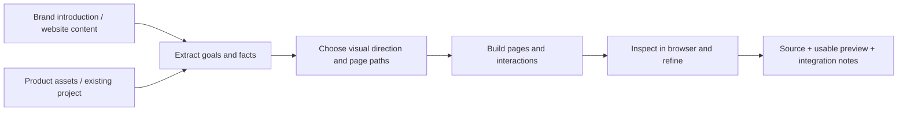

# Website Design Build

[All Skills / 全部 Skills](https://github.com/edward-skills)

**Give an Agent your brand introduction, website content and product materials. Get a designed website with a runnable preview.**

For brand websites, B2B inquiry sites and SaaS marketing sites, including pricing, sign-in and lightweight administration when requested. You do not need to write a sitemap, select a component library or complete a design questionnaire first.

**English** · [简体中文](README.zh-CN.md) · [Quick start](#quick-start) · [Skill](website-design-build/SKILL.md) · [Installation and use](docs/usage.md) · [Validation](docs/validation.md) · [License](LICENSE)


*An actual browser capture of Gather, a fictional feedback collaboration SaaS. The supplied inputs were a brand introduction, product interface materials and plan details. The example website is in Chinese; the Skill can produce the language you request.*

## One workflow, different website tasks

| SaaS pricing | SaaS sign-in |
| --- | --- |
| [](docs/images/gather-pricing.png) | [](docs/images/gather-login.png) |
| Show billing units and actual totals; preserve selections across pages. | Keep the brand consistent and distinguish a UI preview from real authentication. |

| Brand website | Mobile layout |
| --- | --- |
| [](docs/images/evenform-home.png) | <a href="docs/images/gather-mobile.png"></a> |
| Organize photography, product selection and use cases around the product. | Recompose for the task; keep real controls usable rather than shrinking the desktop page. |

Click a screenshot to enlarge it. The [example source](examples/README.md) runs locally; these screenshots are not presented as live public products.

## Quick start

### 1. Install the complete Skill

```bash
npx skills add edward-skills/website-design-build --skill website-design-build
```

Select your Agent in the installer. Add `--global` for a global installation. Compare and back up an existing installation before replacing it. [Manual installation](docs/usage.md#manual-installation) is also supported; copy the complete directory.

### 2. Share what you already have

```text
Use website-design-build.

We make feedback collaboration software for small product teams.
Attached are our brand introduction, product screenshots and plan details.
Build a concise homepage, pricing page and sign-in page with a preview I can open.
Make routine design and implementation choices yourself; do not invent missing
business facts. Use English for the website.
```

Use `$website-design-build` in Codex or `/website-design-build` in Claude Code. Other capable Agents can read `SKILL.md` and its referenced files explicitly. See [host capabilities and invocation](docs/usage.md).

### 3. Open the result and give specific feedback

The default delivery is source for the requested pages and an accessible preview. The Agent maintains its internal brief and specifications. Feedback such as “this heading breaks too often,” “the product image is cropped” or “preserve the existing billing rules” is applied to the relevant pages, breakpoints and states.

## Inputs and outputs



| What you provide | What the Agent handles |
| --- | --- |
| Brand introduction, product capabilities and audience | First-screen message, reading order and primary action |
| Copy, screenshots, photos, logo or existing website | Asset roles, visual direction and mobile composition |
| Plans, inquiry rules and existing interfaces, if available | States, amounts, cross-page context and data paths |
| Existing design or code, if available | Preserve the established system and manual refinements |

Incomplete materials are welcome. Missing facts must remain explicit. Real inquiries, authentication and payment require actual integrations.

## Details the workflow makes executable

- Adjust type size, control height, spacing and visual weight independently.
- Choose focal areas for product photos and SaaS interfaces; recompose for mobile.
- Share plan data across cards, estimators, FAQs and sign-in summaries; clear stale totals after invalid input.
- Verify return paths and preserve plan, billing period, seats and permitted destinations.
- Distinguish visual displays, browser demos and actual authentication, lead capture, payments or backend writes.
- Apply feedback to the affected properties, pages, languages, breakpoints and states.

The [10 reference modules](website-design-build/SKILL.md) are loaded as needed. The detailed Agent instructions are currently in Chinese; the Agent must understand them. **The generated website follows your requested language.**

## Cross-agent support and evidence

The package uses `SKILL.md`, relative references and templates. It does not require a specific model, framework, Figma or hosting platform. `agents/openai.yaml` is optional UI metadata. Output depends on the host's ability to read assets, edit files, run code and inspect a browser.

[Validation records](docs/validation.md) distinguish packaging, installation, independent production and browser inspection. Installer recognition is not proof that every model has passed production testing. See [Meta Muse AI and Grok Bot](docs/usage.md#meta-muse-ai-and-grok-bot) for documented capabilities and current verification limits.

## Rights

**Publicly visible, invocation-only.** You may install and invoke the Skill for your own or client projects, and use, modify, publish and sell resulting websites. Redistribution, resale, repackaging, publishing modified Skill packages and hosting the Skill itself for third parties are not authorized. [Full license](LICENSE) · [Asset notice](NOTICE.md)

GitHub's platform rights to view and fork public repositories still apply. This is a custom use license, not an MIT, Apache or other open-source license.
