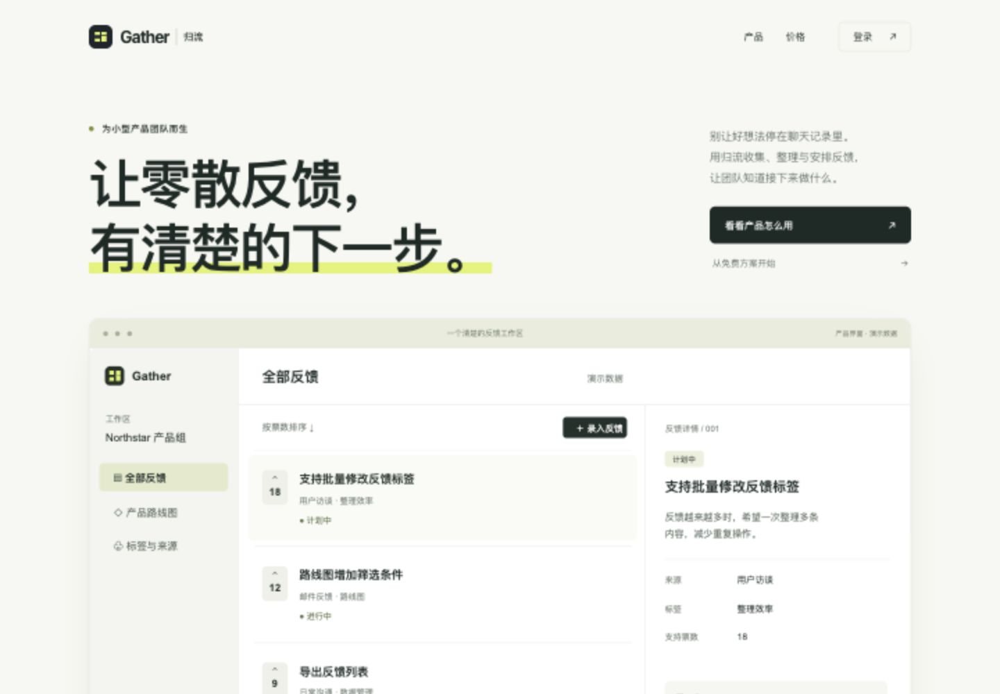
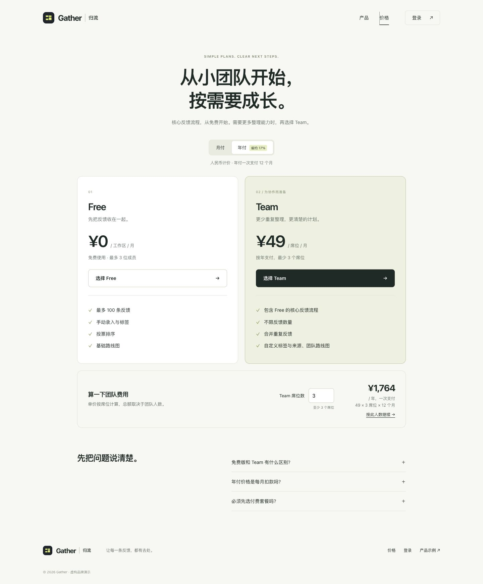
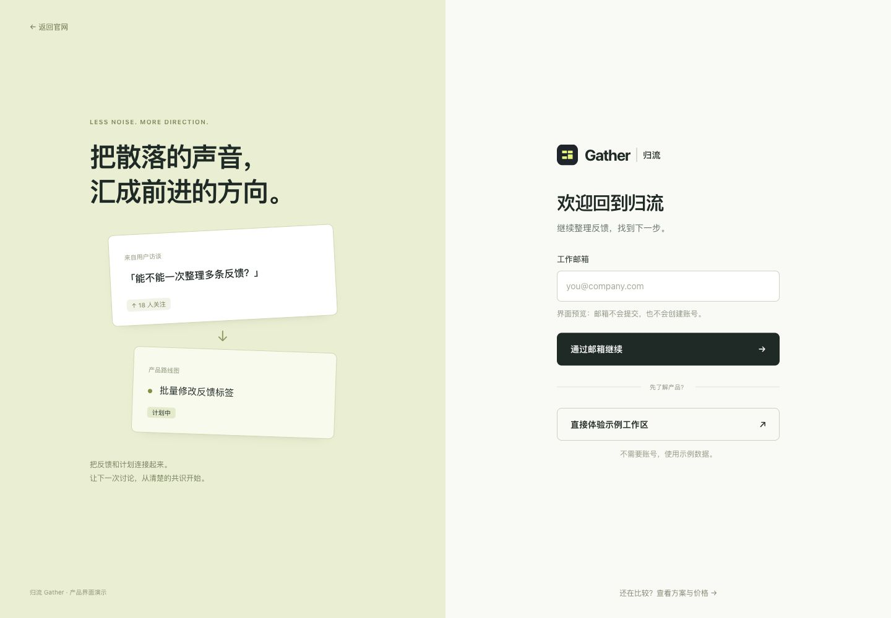
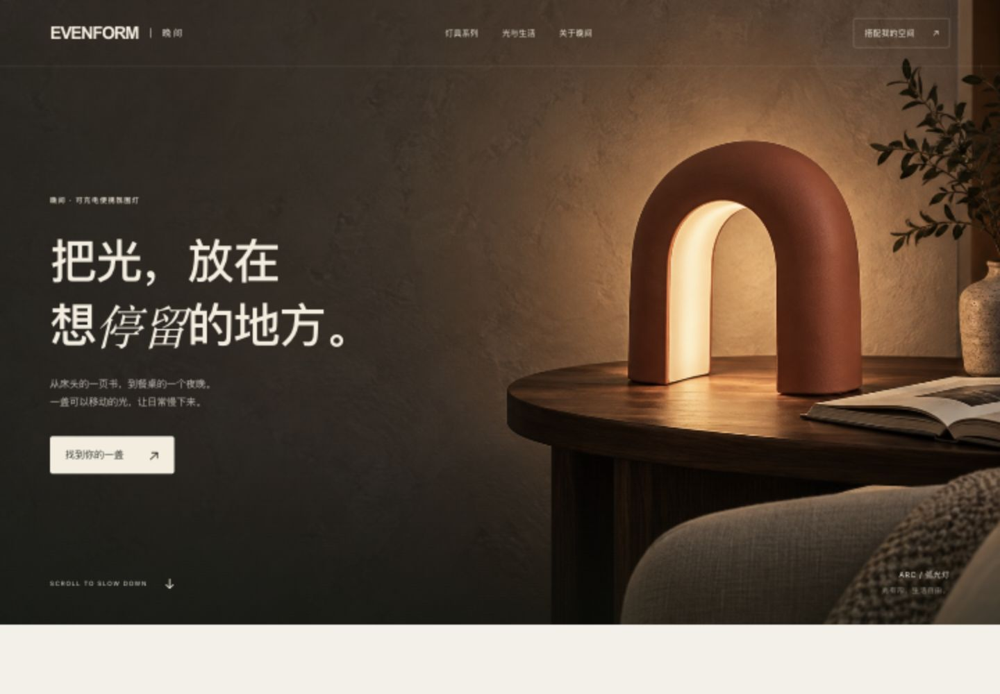
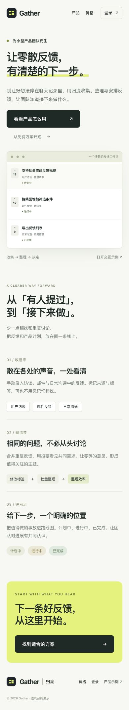
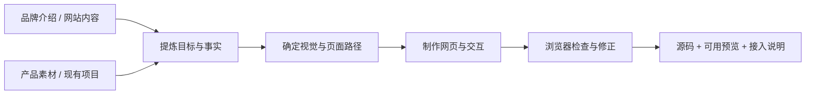

# Website Design Build · 网站设计与搭建

**给品牌介绍、网站内容和产品素材，让 Agent 设计并搭建可预览网页。**

适用于品牌官网、B2B 询盘站与 SaaS 官网，覆盖价格页、登录页和轻量后台。用户不必先写 sitemap、选组件库或填写设计问卷。

[快速使用](#三分钟开始) · [完整 Skill](website-design-build/SKILL.md) · [安装与调用](docs/usage.zh-CN.md) · [验证记录](docs/validation.zh-CN.md) · [English](README.md) · [仅调用许可](LICENSE)



*实际运行的网页截图。归流 Gather 是虚构的反馈协作 SaaS；输入只有品牌介绍、产品界面和套餐资料。*

## 同一套方法，按网站任务设计

| SaaS 价格页 | SaaS 登录页 |
| --- | --- |
| [](docs/images/gather-pricing.png) | [](docs/images/gather-login.png) |
| 显示计价单位与实际总额，跨页保留选择。 | 同一品牌下独立组织表单，区分预览与真实认证。 |

| 品牌官网 | 手机适配 |
| --- | --- |
| [](docs/images/evenform-home.png) | <a href="docs/images/gather-mobile.png"></a> |
| 用产品摄影、选型与场景组织内容。 | 按任务重排，真实控件不随展示图整体缩小。 |

截图可点击放大。页面源码在 [examples/](examples/README.zh-CN.md)，可本地运行；仓库截图不冒充公开在线产品。

## 三分钟开始

### 1. 安装完整 Skill

```bash
npx skills add edward-skills/website-design-build --skill website-design-build
```

根据安装器提示选择你的 Agent。需要安装到全局时增加 `--global`；已有同名版本时先比较、备份。也可以按 [手动安装方法](docs/usage.zh-CN.md) 复制完整目录。

### 2. 给它你已有的内容

```text
使用 website-design-build。

我们是一个面向小型产品团队的反馈协作 SaaS。
附件是品牌介绍、产品截图和套餐资料。
请做首页、价格页和登录页，简洁、清楚，给我可打开的网页预览。
缺失的真实业务信息不要编造；其他设计和实现选择由你完成。
```

Codex 可用 `$website-design-build`；Claude Code 可用 `/website-design-build`。支持文件读取的其他 Agent 也可直接读取完整目录中的 `SKILL.md`，再按提示执行。[调用方式与能力要求 →](docs/usage.zh-CN.md)

### 3. 打开结果，再给具体反馈

默认交付请求范围内的网页与可访问预览。Agent 整理内部 brief 和规格，不要求你补齐模板。你可以继续反馈“这个标题太碎”“产品图裁掉了”“价格页要沿用现有计费逻辑”，它会定位相关页面、断点与状态后修改。

## 输入和输出



| 你已有的材料 | Agent 自行完成的工作 |
| --- | --- |
| 品牌介绍、产品能力与目标客群 | 提炼首屏、阅读顺序与主要动作 |
| 文案、截图、照片、Logo 或现有网站 | 分配素材用途、确定视觉方向与手机构图 |
| 套餐、询盘规则、已有接口（如有） | 对应真实状态、金额、上下文与数据路径 |
| 现有设计稿或代码（如有） | 保留已有系统和手调，修改受影响部分 |

材料不必齐全。缺失事实不靠虚构补足；请求真实询盘、认证或支付时，预览不能替代接入。

## 细节如何落实

- 字号、按钮高度、留白和视觉重量分别调整，避免用缩字掩盖布局问题。
- 产品图与 SaaS 界面按内容选取焦点；手机不机械缩小整张桌面页面。
- 价格卡、估算器、FAQ 和登录摘要共用套餐来源；无效输入不沿用旧金额。
- 核对所有相关返回入口，保留套餐、周期、人数及允许的返回目标。
- 区分页面展示、浏览器演示和真实登录、留资、支付、后台写入。
- 反馈按属性合并，同步受影响页面、语言、断点和状态。

完整步骤按需读取 [10 个参考模块](website-design-build/SKILL.md#按需读取的细节模块)，不要求每次遍历全部文档。

## 跨 Agent 与验证边界

Skill 主体采用标准 `SKILL.md`、相对路径参考和模板，不绑定特定模型、框架、Figma 或托管平台。`agents/openai.yaml` 只提供可选 UI 元数据。支持的产出深度取决于宿主是否能读取素材、编辑文件、运行项目和检查浏览器。

[验证记录](docs/validation.zh-CN.md) 区分格式检查、安装检查、独立生产和浏览器检查；不将某个安装器识别成功写成所有模型均已通过生产验证。

[Meta Muse AI 与 Grok Bot 的使用方式和验证边界 →](docs/usage.zh-CN.md#meta-muse-ai-与-grok-bot)

## 许可

**公开可见，仅调用使用。** 可下载、安装并调用 Skill，为自己或客户生成网页，生成结果可正常使用、修改和商业发布。不授权转售、再分发或发布修改版 Skill，也不授权将 Skill 本身提供为面向第三方的托管服务。[完整条款](LICENSE) · [素材说明](NOTICE.zh-CN.md)

公开仓库仍受 GitHub 平台的查看和 fork 规则约束；这是自定义使用许可，不是 MIT、Apache 等开源许可。
