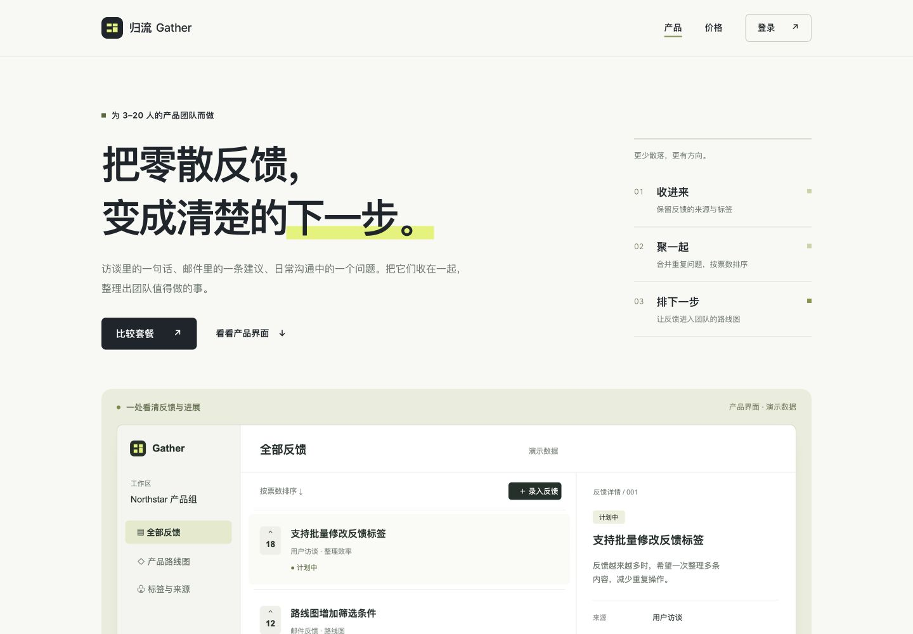

# 验证记录

检查日期：2026-10-17。验证目标是 Skill 能否在没有原会话和预设实现的情况下被另一位执行者理解并实际生产，以及完整包能否被常见宿主的安装器发现。不是全模型基准或真人可用性研究。

## 已完成的层级

| 层级 | 结果 | 证据边界 |
| --- | --- | --- |
| 结构与可移植性 | `SKILL.md` frontmatter、名称、16 文件完整包、相对引用和许可检查通过 | 无私有路径、原会话、指定模型或强制托管依赖；机器检查不证明审美 |
| 安装发现 | `skills` CLI 1.7.2 项目级安装到 Codex、Claude Code、Cursor、OpenCode，文件哈希与源包一致 | 安装在隔离目录，未改已有全局配置；不等于四个平台均实际运行模型 |
| 原始案例 | 虚构灯具品牌 EVENFORM；虚构 SaaS Gather 三页 | 同一执行者完成与自查；源码见 examples；不是独立盲测 |
| 独立生产 A | 新上下文 Codex Agent，仅给 Skill 快照和 Gather 原始品牌/产品素材，产出三页与静态构建 | 未给既有网页实现、先前缺陷或预期答案；10 项计算/状态测试及静态检查、构建通过 |
| 独立生产 B | 另一新上下文 Codex Agent，仅给 Skill 快照和 LUMERO 英文 B2B 原始介绍/图片，产出单页选型与项目草稿 | 没有追问技术栈和版式；6 项数据/导出测试及静态检查、构建通过 |
| 主执行者浏览器复核 | 两个独立产物都实际加载，并完成下表相关路径 | 范围有限，未把 Node 测试或无溢出测量写成全功能验收 |

独立生产使用了发布前的工作流快照；发布前随后补充跨 Agent 能力适配说明与用户指定的仅调用许可，方法和业务模块未因此改写。安装检查使用带最终许可与适配说明的完整包。

## 独立产物画面

| 独立 SaaS Agent | 独立 B2B Agent |
| --- | --- |
| [](images/independent-saas.png) | [](images/independent-b2b.png) |

它们是执行者自行设计的实际网页，不是把主执行者的网页复制一份或只审查 Skill 文本。

## 浏览器实际复核

| 产物 | 操作 / 观察 | 结果 |
| --- | --- | --- |
| 独立 SaaS | 选择 Team 年付 5 席位 | 显示 ¥2,940/年 |
| 独立 SaaS | 进入登录 → 修改 | 登录摘要与返回周期、人数一致 |
| 独立 SaaS | 人数改成 2 | 显示原因、总额变为破折号、继续链接没有目标 |
| 独立 SaaS | 390px 加载三页 | 页面无横向溢出，相关图片加载；桌面首页已目视检查 |
| 独立 B2B | 添加 PEBBLE 与 ARC，填写数量 12 和中英文项目文本，刷新 | 两产品、数量与项目文本恢复 |
| 独立 B2B | 桌面与 390px | 首屏目视检查；手机无横向页面溢出、产品图加载；比较区采用自身横向滚动 |
| 两个产物 | 浏览器控制台 | 本次检查无 warn/error |

原始 Gather 案例还检查了 320、390、720、768、1440px 三页布局、金额边界、登录预览与示例投票；本仓库示例不包含真实认证或支付。EVENFORM 案例已检查产品详情、场景切换、浏览器保存和实际下载。

## 未宣称通过的项目

- Claude、Cursor、OpenCode 的实际模型生产：只完成安装层检查，没有登录这些产品并执行生成。
- 全部模型、全部浏览器、真机软键盘、屏幕阅读器或所有内容长度的质量保证。
- 真实账户、OAuth、邮件发送、支付、询盘持久化、后台权限和多地区业务。
- 独立 B2B 产物的浏览器下载文件/剪贴板结果：执行者有纯导出规则测试，主复核此次仅验证选择、填写与刷新恢复。

Skill 能提供具体可执行的方法和验收标准；最终质量仍取决于素材、宿主工具和执行者的实际检查。新接入真实业务时，按相关模块完成真实流程验证。

## 自行检查仓库

```bash
python3 scripts/validate_repository.py
node --check examples/gather/dist/app.js
node --check examples/gather/dist/assets/catalog.js
node --check examples/evenform/dist/app.js
```

GitHub Actions 执行同类包装检查。该脚本不调用在线服务，也不将“结构通过”称为生产站点已经接通。
